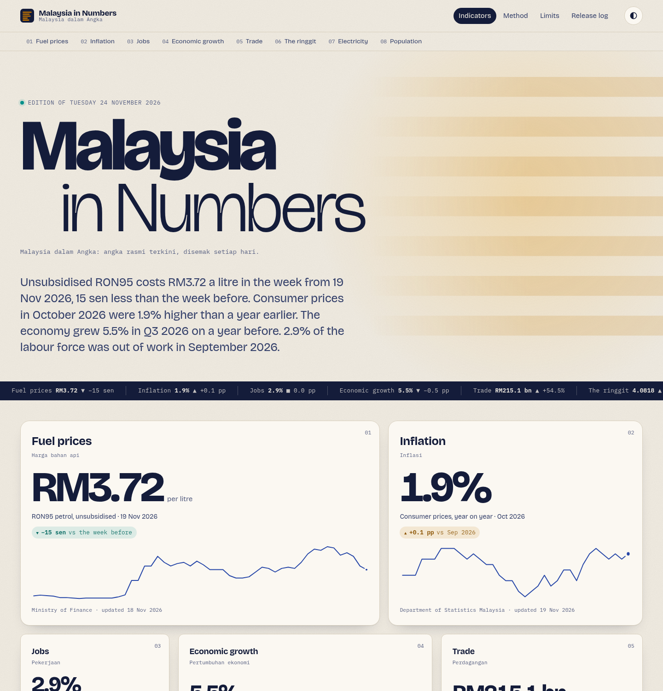

<p align="center"></p>

# Malaysia in Numbers

[](https://github.com/VinVirtual/malaysia-in-numbers/actions/workflows/test.yml) [](LICENSE) [](DATA-LICENSE.md)

A self-updating dashboard of Malaysia's official open data: fuel prices, inflation, jobs, growth, trade, the ringgit, electricity and population, with accessible charts, the table behind every chart and CSV downloads. Each build also writes the latest figures as a JSON Feed (`feed.json`) and as plain JSON (`latest.json`).

Open source: this repository hosts nothing itself. Build it on your machine in a minute, or [deploy your own](#deploy-your-own) on GitHub Pages or Cloudflare Pages. Once a day a GitHub Action asks the official [data.gov.my API](https://developer.data.gov.my/) for eight datasets, one request each, checks every reply, commits a compact copy of the data (so history builds up in Git and in a release log), builds a static site and publishes it. There is no server, no database, no key and no npm package at runtime.

Screenshots: [`docs/home-light.png`](docs/home-light.png), [`docs/home-dark.png`](docs/home-dark.png), [`docs/home-phone.png`](docs/home-phone.png), [`docs/fuel-light.png`](docs/fuel-light.png) (crosshair and tooltip), [`docs/inflation-dark.png`](docs/inflation-dark.png), [`docs/ringgit-phone.png`](docs/ringgit-phone.png), [`docs/method.png`](docs/method.png).

## The datasets

Each id, publisher and cadence was checked against the API's own `meta` block on 24 November 2026; all eight were updated on schedule then. All are CC BY 4.0.

| Page | Dataset id (endpoint) | Publisher | Cadence | Data to (24 Nov 2026) | What is shown |
|---|---|---|---|---|---|
| Fuel prices | `fuelprice` (data-catalogue) | Ministry of Finance | weekly | week of 19 Nov 2026 | RON95 (unsubsidised and BUDI95), RON97, diesel Peninsular and East Malaysia |
| Inflation | `cpi_headline_inflation` (opendosm) | DOSM | monthly | Oct 2026 | headline CPI year on year, 13 divisions, month on month |
| Jobs | `lfs_month` (opendosm) | DOSM | monthly | Sep 2026 | unemployment rate, participation rate, unemployed people |
| Economic growth | `gdp_qtr_real` (opendosm) | DOSM | quarterly | Q3 2026 | real GDP growth year on year, GDP at constant 2015 prices |
| Trade | `trade_sitc_1d` (opendosm) | DOSM | monthly | Sep 2026 | exports, imports, trade balance |
| The ringgit | `exchangerates` (data-catalogue) | Bank Negara Malaysia | monthly | Oct 2026 | monthly average RM per USD, SGD, EUR, CNY |
| Electricity | `electricity_consumption` (data-catalogue) | TNB, SESB, Sarawak Energy, Energy Commission, DOSM | monthly (about 4 months' lag) | Jun 2026 | total, commercial and domestic use |
| Population | `population_malaysia` (opendosm) | DOSM | yearly | 2026 | total since 1970, by ethnic group and citizenship |

Left out on purpose: the Overnight Policy Rate (not in the API's `interestrates` dataset), state population (last updated 2023) and daily births (stopped in July 2023). The Limits page says so.

## How it works

| Stage | File | What happens |
|---|---|---|
| 1. Ask | `scripts/lib/api.mjs`, `http.mjs`, `budget.mjs`, `cache.mjs` | one `GET` per dataset with `meta=true`, 16 s apart (the API allows 4 a minute); HTTPS to one host, redirects refused, size and time caps, a 429 waits for `Retry-After` (or 65 s) and retries once |
| 2. Check | `api.mjs`, `extract.mjs` | the reply must name the dataset asked for, carry its dates, a real calendar date on every row and never two values for one date; empty values are left out, never zero; float noise is rounded away (15 significant digits) |
| 3. Store | `store.mjs`, `fetch.mjs` | `data/series/<id>.json` is rewritten only when a value or the source's dates changed; a reply that would delete stored values or end earlier than before is refused as broken; `data/releases.jsonl` gets one line per change, counting new and revised values |
| 4. Shape | `topics.mjs`, `model.mjs` | headline value and change (pp, sen or %; against the period before, or the same month a year before for seasonal series), chart specs, tables, CSV rows |
| 5. Draw | `assets/js/chart-core.js`, `render/*.mjs` | SVG line, bar and horizontal bar charts drawn at build time, so pages work without JavaScript; in the browser the same code redraws at the real width and adds the crosshair, tooltip and keyboard reading |
| 6. Site | `site.mjs`, `feeds.mjs` | 13 pages, 28 CSV files, per-dataset JSON, `feed.json`, `latest.json`, `_headers`; then a check for broken links, inline code, CSP and size |

## Quick start

Needs Node 22 or newer. No npm packages are needed to fetch or build. The data up to 24 November 2026 is committed, so the site builds without the network.

```bash
git clone https://github.com/VinVirtual/malaysia-in-numbers && cd malaysia-in-numbers
./check_env.sh               # says how to fix anything missing
./mnum site                  # data/ -> dist/, checked
python3 -m http.server -d dist 8000   # open http://localhost:8000/
```

More commands:

```bash
./mnum fetch                 # ask the API (8 requests, about 2 minutes), update data/
./mnum fetch --offline       # rebuild data/ from cached replies only, no network
./mnum fetch --only fuelprice,lfs_month
./mnum check                 # validate the committed data
npm test                     # unit tests, no network
npm ci && npm run test:e2e   # browser test of dist/ (needs Chrome)
npm run capture              # screenshots into docs/
```

The site URL is used in the feed and in link previews. It defaults to `http://localhost:8000/` for local builds; set your own with the `MNUM_SITE_URL` environment variable (https, ending in `/`). `MNUM_CHROME` points the browser test at a Chrome or Chromium binary.

## Deploy your own

### GitHub Pages (built in)

[`.github/workflows/deploy-pages.yml`](.github/workflows/deploy-pages.yml) fetches, commits what changed, builds the site and publishes it with `actions/deploy-pages`. In this repository it only runs when started by hand, so nothing is hosted from here. In your fork:

1. Fork the repository (public forks get free Actions minutes).
2. Settings, Pages, Source: **GitHub Actions**.
3. Settings, Actions, General, Workflow permissions: **Read and write**, so the workflow can commit `data/`.
4. In `deploy-pages.yml`, uncomment the two `schedule` lines (every day at 01:23 UTC, 09:23 in Malaysia) and push.
5. Actions, deploy-pages, **Run workflow**.

The site URL comes from GitHub Pages. For a custom domain, set the repository variable `MNUM_SITE_URL` (Settings, Secrets and variables, Actions, Variables), for example `https://data.example.org/`.

Rights are empty at the top and granted per job; every action is pinned by commit SHA.

| Job | Rights | When | What it does |
|---|---|---|---|
| `fetch` | `contents: read`, no stored credentials | every run | unit tests, fetch, validate, build the site; hands the data files on as an artifact if anything changed |
| `commit` | `contents: write` | only if something changed | copies only `data/series/*.json` and `data/releases.jsonl`, validates, commits as `github-actions[bot]`, rebases, validates again, pushes |
| `deploy` | `pages: write`, `id-token: write` | every day the fetch succeeded, or `deploy_only` | builds from the default branch and publishes to GitHub Pages, so the edition date is today's and a failed deploy is retried the next day |
| `alert` | none | only if a dataset failed | fails the run after everything else has finished, so a partial failure is a red run and a GitHub email, not just a warning |

### Cloudflare Pages (alternative)

Cloudflare Pages also reads the `_headers` file the build writes, so the CSP is sent as a real header with `frame-ancestors 'none'`, `X-Frame-Options: DENY`, `nosniff`, `Referrer-Policy`, `Permissions-Policy` and the feed and CSV media types (GitHub Pages ignores `_headers`; the pages carry the CSP in a meta tag either way). By hand:

```bash
MNUM_SITE_URL=https://<your-project>.pages.dev/ ./mnum site
npx wrangler pages deploy dist --project-name <your-project> --branch main
```

To run it on a schedule, replace the last three steps of the `deploy` job with [`cloudflare/wrangler-action`](https://github.com/cloudflare/wrangler-action) and `command: pages deploy dist --project-name=<your-project>`, drop `pages` and `id-token` from its rights, and add repository secrets `CLOUDFLARE_ACCOUNT_ID` and `CLOUDFLARE_API_TOKEN` (a token with Account, Cloudflare Pages, Edit only).

### Cost

Actions minutes are free on public repositories. A private fork gets 2,000 a month, billed per job rounded up to the minute. A live fetch takes about two minutes (8 requests 16 s apart: 115 s measured on 24 November 2026), so a normal day costs the fetch job (about 3 billed minutes) and the deploy job (1), and a day with a new release 1 more for the commit: roughly **135 minutes a month**. Every job has a timeout; even if every one ran to its limit every day the month would stay under 2,000 minutes. Commits made by the workflow do not trigger the test workflow.

The data.gov.my API needs no key and allows 4 requests a minute; a run makes 8, spaced 16 s apart.

[`.github/workflows/test.yml`](.github/workflows/test.yml) runs on push and pull request: unit tests, data validation, site build and the browser test.

## Safety

- Everything from the API is untrusted. Replies are checked before use; series keys are reduced to `[a-z0-9_]`; dataset files are validated against a schema before every build. Every value is HTML-escaped by default, SVG text is escaped by the chart engine, and CSV text cells that start with `= + - @` are defused.
- Pages carry a strict CSP (`default-src 'none'`, scripts, styles and fonts from the site only, `connect-src 'none'`), as a `<meta>` tag and, on hosts that read `_headers` (Cloudflare Pages, Netlify), as a header. No inline script or style, no CDN, fonts self-hosted. The build fails on an inline script, a `style` attribute, an event handler, a non-https link or a broken local link.
- Files are written to a temporary name and renamed; symlinks on the way are refused; nothing is written outside the project.

## Tests

131 tests: 119 unit tests (`node --test tests/*.test.mjs`, no network, against API replies recorded on 24 November 2026 and trimmed to their last 14 dates in [`tests/fixtures/`](tests/fixtures/)) and 12 browser tests (`tests/e2e/`). They cover building requests, checking and reshaping replies, the HTTP layer (host allow-list, redirects, size caps, timeouts, 429 handling, the 16 s spacing, budgets, cache, offline mode, symlinks), the stored files and release log (validation, revisions, a failing, shrinking or malformed reply keeping the last good file, the budget stopping a run, the CLI refusing to wipe folders), formats and changes, the chart engine (ticks, gaps, negative bars, labels, accessibility text, escaping), every chart of every topic, the built site (CSP, links, ids, 404, headers, feeds, CSV), the workflows (pins, rights, the schedule off in this repository, the red run on partial failure, the append-only log, timeouts), and in Chrome: no errors or off-site requests on any page, charts redrawn at the shown width, keyboard reading and announcements, hover tooltip, CSV download, theme toggle, no sideways scroll at 360 px, landmarks and labels, WCAG AA text contrast in both themes, reduced motion, and the site without JavaScript.

## Limits

- **Not an official source.** An independent site that republishes open data. It is not affiliated with any agency. Check the publisher's release before relying on a figure; every chart links to it.
- **Figures are revised.** The site shows the latest version only. Earlier versions are in Git and counted in the release log, but not drawn side by side.
- **Up to a day late.** If the API fails, the previous figures stay up; the run turns red in the Actions log, but the site does not say so. Each page shows the last day this site picked up a change for it, not the last day it looked (recording every check would mean a commit every day).
- **The API's dates are taken as given.** Its time zone is not stated; the feed reads them as Malaysia time.
- **No seasonal or price adjustment** of anything; trade is in current ringgit. Changes are computed only for the headline numbers and the trade balance; everything else is the publishers' own.
- **Colour means direction, not good or bad.**
- **Horizontal bar charts** (CPI by division, population by group) print every value beside its bar and have no keyboard cursor; the line and bar charts do.
- **Malay labels:** CPI division names are DOSM's own; the other Malay headings were written for this site and have not been reviewed by a translator.
- **Tested in Chromium only** (headless, phone and desktop widths, both themes). Node 24 locally, Node 22 in CI.
- Some figures look surprising but are as published, for example exports of RM215.1 bn in September 2026, 54.5% above September 2025.

## Contributing

Issues and pull requests are welcome. See [CONTRIBUTING.md](CONTRIBUTING.md).

## Licence

Code: MIT ([`LICENSE`](LICENSE)), copyright Lashvin Manimaran. Data is not covered by the MIT licence: the figures in `data/`, `tests/fixtures/` and on the built site are © their publishers, CC BY 4.0, via data.gov.my and OpenDOSM (see [`DATA-LICENSE.md`](DATA-LICENSE.md)). Keep the attribution in the site footer if you publish your own copy. Fonts: Bricolage Grotesque and IBM Plex Mono, SIL Open Font License 1.1 (texts in `assets/fonts/`).
